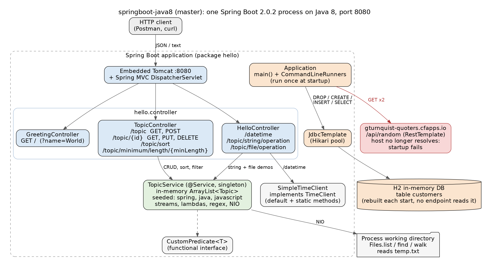

# springboot-java8
The project is made on spring boot. The project summarize the new features present in Java 8.
It contains a hardcoded, in-memory list of topics. You can call the APIs with POSTMAN to add, delete and update topics.
In addition, it uses: 
1) Java 8 NIO methods 
2) String operations
3) Stream operations
4) IntStream functions
5) Functional interface
6) Lambda functions
7) Optional datatype
8) Foreach loops
9) Default and Static methods in interface
10) Java 8 LocalDateTime API
11) Pattern

## Architecture

See [docs/architecture.md](docs/architecture.md) for the components, the full API behaviour, the startup sequence and the build files, with a diagram ([source](docs/diagrams/architecture.dot)).



## Getting Started

Clone the project:

```
git clone https://github.com/COG-GTM/springboot-java8.git
```

### Prerequisites

1) JDK 8
2) Maven 3
3) POSTMAN, curl or any other HTTP client

### Running

The app listens on `localhost:8080`. Start it from the repository root, because `/topic/file/operation` reads the current working directory and `temp.txt`.

Two things on `master` stop the usual `mvn spring-boot:run` / `java -jar` flow:

1) `pom.xml` declares `<packaging>pom</packaging>`, so `mvn package` succeeds without compiling anything or building a jar.
2) At startup the app fetches a quote from `http://gturnquist-quoters.cfapps.io/api/random`. That host no longer resolves, so startup fails with `UnknownHostException`.

[Running master locally](docs/architecture.md#running-master-locally) has the commands that compile and start the unchanged code with a local stand-in for the quote service. The Gradle files (`build.gradle`, Gradle 4.6 wrapper) do not declare the JDBC and H2 dependencies, so use Maven.

## Available API's

Greetings (optional `?name=`, defaults to `World`)
```
GET /
```
Get all Topics in List
```
GET /topic
```
Get Topic of given ID
```
GET /topic/{id}
```

Add Topic in List
```
POST /topic
```
Update Topic of given ID
```
PUT /topic/{id}
```
Delete Topic of given ID
```
DELETE /topic/{id}
```

Get all Topics whose ID's length is greater than minLength
```
GET /topic/minimum/length/{minLength}
```

Get all Topics sorted by ID (sorts the stored list in place)
```
GET /topic/sort
```

String Operations on Topic List
```
GET /topic/string/operation
```

File Operations on Topic List
```
GET /topic/file/operation
```
Java 8 Date Time example
```
GET /datetime
```

Topic bodies are JSON: `{"id": "go", "subjectName": "Go", "subjectDescription": "Go Description"}`. Topics are kept in memory and reset on every restart.

## Helpful Links
Spring:

https://spring.io/guides

Java 8: 

http://www.baeldung.com/java-8-functional-interfaces

http://winterbe.com/posts/2015/05/22/java8-concurrency-tutorial-atomic-concurrent-map-examples/

https://docs.oracle.com/javase/tutorial/java/IandI/defaultmethods.html

http://winterbe.com/posts/2014/07/31/java8-stream-tutorial-examples/

http://www.oracle.com/technetwork/articles/java/ma14-java-se-8-streams-2177646.html

https://docs.oracle.com/javase/tutorial/essential/io/pathOps.html

https://docs.oracle.com/javase/8/docs/api/java/util/Optional.html

http://www.baeldung.com/foreach-java

http://winterbe.com/posts/2015/03/25/java8-examples-string-number-math-files/

http://www.baeldung.com/java-8-comparator-comparing

http://www.baeldung.com/java-8-sort-lambda

https://dzone.com/articles/java-8-friday-goodies-new-new


## Built With

* [Maven](https://maven.apache.org/) - Dependency Management

## Authors

* **Rehman Murad Ali** 


