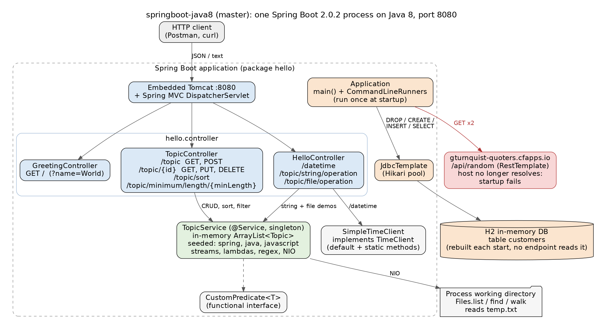

# Architecture

This page describes what the code on `master` does today: a single Spring Boot 2.0.2 application on Java 8 that serves a small REST API over an in-memory topic list and a few endpoints that demonstrate Java 8 language and library features.



The diagram source is [`diagrams/architecture.dot`](diagrams/architecture.dot) (Graphviz). After editing it, run [`diagrams/render.sh`](diagrams/render.sh) to regenerate [`architecture.png`](diagrams/architecture.png) and [`architecture.svg`](diagrams/architecture.svg).

## Components

All code lives under `src/main/java/hello`.

| Component | File | What it does |
| --- | --- | --- |
| `Application` | `Application.java` | `@SpringBootApplication` entry point. Starts the context, prints every bean name, and runs the startup tasks below. |
| `GreetingController` | `controller/GreetingController.java` | `/` returns `{"id": n, "content": "Hello, <name>!"}`; `name` defaults to `World` and `id` is an `AtomicLong` counter. The mapping has no HTTP method, so it answers any method. |
| `TopicController` | `controller/TopicController.java` | Topic CRUD and list endpoints under `/topic`. Delegates everything to `TopicService`. |
| `HelloController` | `controller/HelloController.java` | `/datetime` (`LocalDateTime`, `ChronoUnit`, `ZoneId`, via `SimpleTimeClient`) and the `/topic/string/operation` and `/topic/file/operation` demos, which return one long plain-text string built from `TopicService` results. |
| `TopicService` | `service/TopicService.java` | Singleton `@Service` holding a `java.util.ArrayList<Topic>` seeded with `spring`, `java` and `javascript`. Implements every topic operation with streams, `IntStream`, lambdas, `Comparator.comparing`, `Pattern`, and NIO `Files.list` / `find` / `walk` / `newBufferedReader`. |
| `CustomPredicate<T>` | `declaration/CustomPredicate.java` | Hand-written functional interface used by the minimum-length filter. |
| `TimeClient` / `SimpleTimeClient` | `declaration/TimeClient.java`, `model/SimpleTimeClient.java` | Interface with a `static` and a `default` method, and its implementation over `LocalDateTime`. |
| Models | `model/Topic.java`, `Greeting.java`, `Customer.java`, `Quote.java`, `Value.java` | Plain Java objects serialized by Jackson. `Customer` maps H2 rows; `Quote` / `Value` map the external quote API's JSON. |

`src/main/resources/public/index.html` is an empty placeholder page. The root `application.properties` contains only a commented-out `server.port`, so the app uses Spring Boot defaults (port 8080, auto-configured in-memory H2 data source).

## HTTP API

| Method | Path | Handled by | Behaviour |
| --- | --- | --- | --- |
| any | `/` | `GreetingController` | Greeting JSON; optional `?name=`. |
| any except POST | `/topic` | `TopicController` | All topics, in the list's current order. |
| any except PUT, DELETE | `/topic/{id}` | `TopicController` | First topic with that id. An unknown id returns HTTP 500 (`No value present`). |
| POST | `/topic` | `TopicController` | Appends the JSON body as a new topic; empty 200 response. Ids are not checked for duplicates. |
| PUT | `/topic/{id}` | `TopicController` | Replaces the first topic with that id by the body (the body's own `id` is stored); does nothing if the id is unknown. |
| DELETE | `/topic/{id}` | `TopicController` | Removes every topic with that id. |
| any | `/topic/sort` | `TopicController` | Sorts the shared list by id **in place** and returns it, so later `GET /topic` calls also come back sorted. |
| any | `/topic/minimum/length/{minLength}` | `TopicController` | Topics whose id is longer than `minLength`. |
| any | `/datetime` | `HelloController` | Plain text: now, tomorrow, a month ago, leap year, system zone, and the time in `Canada/Central`. |
| any | `/topic/string/operation` | `HelloController` | Plain text: ids joined with `:`, their distinct sorted characters, the ids containing `java`, and the ids containing `g`. |
| any | `/topic/file/operation` | `HelloController` | Plain text: files in the working directory, paths starting with `grad` (via `Files.find` and `Files.walk`), and the lines of `temp.txt` that contain `print`. |

Mappings that do not name an HTTP method answer every method that no more specific mapping claims, so for example `PUT /topic` returns the list. Request and response bodies are `Topic` JSON: `{"id": "...", "subjectName": "...", "subjectDescription": "..."}`.

## State and data

- **Topics** live only in `TopicService`'s `ArrayList`. They reset on every restart and are shared, unsynchronized, by all requests.
- **H2**: at startup, `Application.run` drops and recreates an in-memory `customers` table, inserts four names with `JdbcTemplate.batchUpdate`, and logs the rows whose first name is `Josh`. No endpoint reads this table.
- **Filesystem**: the file-operation endpoint reads the process's current working directory (`Paths.get("")`) and `temp.txt` relative to it, so its output depends on where the app was started. Run it from the repository root to get the intended output.

## Startup sequence

1. `SpringApplication.run` builds the context (Tomcat, Spring MVC, Jackson, Hikari + H2, `JdbcTemplate`, and a `RestTemplate` bean).
2. The command-line runners run: `Application.run` sets up the H2 `customers` table, and the `run(RestTemplate)` bean calls `GET http://gturnquist-quoters.cfapps.io/api/random` and logs the quote.
3. Back in `main`, the app prints every bean name and calls the same quote URL again with a new `RestTemplate`.

The quote host no longer resolves, so step 2 throws `UnknownHostException` and the application exits during startup. Nothing serves requests on `master` unless that host is reachable (for example through a stub, as below).

## Build

| File | State on `master` |
| --- | --- |
| `pom.xml` | Spring Boot 2.0.2 parent, `java.version` 1.8, dependencies `spring-boot-starter-web`, `spring-boot-starter-jdbc`, `h2`, `spring-boot-properties-migrator`. It declares `<packaging>pom</packaging>`, so `mvn package` succeeds but compiles nothing and builds no jar. |
| `mvnw`, `.mvn/wrapper` | Maven 3.3.9 wrapper, downloads from repo1.maven.org. `mvnw` is not marked executable. |
| `build.gradle`, `gradlew` | Gradle 4.6 wrapper; only `spring-boot-starter-web` is declared, so the JDBC/H2 code would not compile with it. `gradlew` is not marked executable. |
| `target/classes`, `gs-spring-boot.iml`, `.idea/` | IDE build output and IntelliJ project files committed to the repository. |

There are no tests (`src/test` does not exist) and no CI.

## Running `master` locally

Because of the `pom` packaging and the dead quote host, the app cannot be started with a plain `mvn spring-boot:run` or `java -jar`. This sequence runs the code unchanged on JDK 8 and Maven 3, from the repository root:

```bash
# 1. Resolve the dependency classpath and compile (-parameters matches the Boot parent's compiler settings,
#    which @PathVariable needs to bind parameter names).
mvn -q dependency:build-classpath -Dmdep.outputFile=/tmp/cp.txt
mkdir -p /tmp/classes
javac -parameters -d /tmp/classes -cp "$(cat /tmp/cp.txt)" $(find src/main/java -name '*.java')
cp -r src/main/resources/* /tmp/classes/

# 2. Serve a stand-in quote on 127.0.0.1:18099 and route the app's HTTP calls through it.
python3 -c '
from http.server import BaseHTTPRequestHandler, HTTPServer
class H(BaseHTTPRequestHandler):
    def do_GET(self):
        b = b"{\"type\":\"success\",\"value\":{\"id\":1,\"quote\":\"stub\"}}"
        self.send_response(200); self.send_header("Content-Type", "application/json")
        self.send_header("Content-Length", str(len(b))); self.end_headers(); self.wfile.write(b)
HTTPServer(("127.0.0.1", 18099), H).serve_forever()' &

java -Dhttp.proxyHost=127.0.0.1 -Dhttp.proxyPort=18099 -cp "/tmp/classes:$(cat /tmp/cp.txt)" hello.Application
```

Then call the API on `http://localhost:8080`, for example `curl localhost:8080/topic`. Calls to `localhost` bypass the proxy setting.
